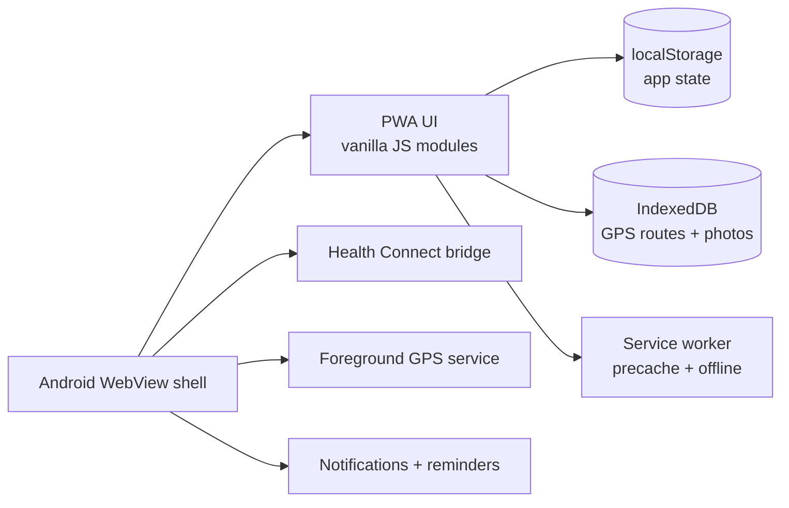

<p align="center">
  
</p>

<h1 align="center">openHybrid</h1>

<p align="center">
  Offline-first hybrid strength and running tracker.<br>
  Vanilla JavaScript PWA with a custom Android WebView shell.
</p>

> **Status: pre-release, local-first, open source.** openHybrid is licensed under the
> GNU Affero General Public License v3.0 (`AGPL-3.0-only`). There is no account
> system and no cloud sync: training data stays on the device, with JSON/CSV
> export and Android automatic backups for moving it. The hosted PWA is a
> preview of the same app.

## What it does

openHybrid is a training app for people who lift and run. It keeps the fast logging
workflow of a strength app while treating running, recovery and load as part of
the same training picture.

- **Decision-first Home** — a seven-day "This week" rail followed by one Today
  card (Start / Resume / Review), a compact bodyweight card with one-tap
  logging, a coach insight and quick actions. Training balance, strength and
  endurance sit below it; deep charts live in Progress.
- **Strength logging** — routines, set types, RIR/RPE per set, rest timers with
  group rest for supersets and circuits, exercise swaps, per-side plate math,
  estimated 1RM and PRs. Every target says *why* (the engine's stall/fatigue
  evidence, the progression rationale or the program prescription). Favourite
  lifts lead the picker, and an optional warm-up ramp adds editable 40/60/80%
  sets once you enter the first working weight.
- **Progress as one dashboard** — bands answer one question each: **Pulse**
  (current week, streak and body map), **Main exercises** (ranked lifts, progress
  checks and rep-range/effort mix), **Muscles** (credited sets against the
  typical range), **Body** (weight, body fat, measures and photos), **Balance**,
  **Endurance**, **Fasting** and **Reviews**. One 30D/3M/1Y/All range bar drives
  them; each band's detail carries the exact rows and tables, and an
  always-available year heatmap shades every day by measured time.
- **Reviews** — one Week | Month | Year surface: the weekly story (volume,
  adherence, PRs, next-week focus), a **Block Review** of the last four completed
  weeks (sessions, tonnage, per-lift e1RM change, PRs and progress checks) with
  one evidence-gated **Deload week** action and Undo on a personal plan, the
  Training Report and consistency log, and a seasonal Year in Review alongside
  the year calendar.
- **Running** — manual entries, native GPS tracking with a route map, splits,
  FIT-file import and run analytics, plus **best efforts** (fastest 1 km/1 mi/5
  km/10 km from recorded splits) and labelled race-time estimates. Runs, walks
  and strength are counted separately and attributed to the calendar day they
  happened.
- **Recovery and load** — readiness, training load, ACWR and a weekly review.
  Progress → Muscle Load shows weekly volume, recovery and untrained muscles per
  muscle group.
- **Health Connect** (Android) — steps, resting heart rate, HRV and sleep, read
  only and field by field.
- **Bodyweight and fasting** — a Progress graph with daily weigh-ins, a 7-day
  average, weekly means, an optional goal line and a 21-day weekly-rate corridor.
  Weigh-ins open a prefilled sheet with ±0.1/±0.5/±1 steppers and recent entries,
  so the usual log is one tap. Measures add tape sites (cm/in), entered body fat
  and progress photos on one dated entry. Fasting protocols complete the picture.
- **Programs** — a catalogue of strength, hypertrophy, running and hybrid
  programmes, a program builder, and portable plan files. Discover is one
  searchable list; saved, completed and custom/imported plans share My Plans.
- **Equipment profiles** — keep separate kits for home and the commercial gym.
  Each profile stores its own bar weight, plate denominations and optional pairs
  owned, dumbbell ladder and machine stacks; the active profile drives program
  fit, exercise swaps and optional per-side plate hints. Hints say when a target
  cannot be built, and suggested loads snap to the weights you record.
- **Settings that hold** — five destinations (Profile, Training, Health,
  Appearance, Data) over one validated settings registry, with search, per-page
  reset and Undo. Units, week start, modules, palettes, reminders and every
  training preference live there; Progress, Plans and Measures link to the page
  that owns the value they show.
- **Modules** — hide Running & GPS, Fasting, Health Connect or Recovery & Load
  from Settings → Modules. Hiding a module never deletes its data.
- **Themes & layout** — Midnight is the default icon-derived palette (navy,
  steel, cyan, lime); Slate, Forest and Ember are alternatives. Light keeps its
  own colours. Home and Progress let you hide optional cards and reset to the
  default without touching the data.
- **Bring and move your data** — import OpenGym, Strong or Hevy CSV files
  (strength sets, cardio rows as archived runs, weigh-ins), bodyweight and
  measurement CSVs, or a batch of Garmin/Wahoo/Coros FIT activities. FIT runs
  keep date, distance, pace, HR and GPS; strength FIT files import time/HR only
  because the format has no exercise names. Export a full JSON backup, the
  training log, bodyweight/measurements CSV, or the progress-photo archive.
- **Correct saved workouts** — History lets you reopen a finished strength
  session or run and fix weights, reps, distance, HR or notes in place without
  changing its date or identity, and **Log past** records a session on the day it
  actually happened (a one-off that never rewrites the active plan).
- **Progression styles** — custom programs can choose Double, Linear or Rep-first
  coaching. The suggested next load follows that program's style while keeping
  RPE, fatigue, cutting and stall safeguards.
- **Durable on Android** — the shell mirrors the same state into app-private
  storage, so WebView eviction or a full localStorage quota does not lose the
  last change; a failed write is reported instead of silently claiming success.
- **Android shell** — bundled assets in a hardened WebView with native Health
  Connect, GPS and notification bridges.

## What's next

The active programme is Roadmap v2, sequenced **Settings/Profile → Home →
Logging → Progress**. H2–H5 and the Progress rebuild are delivered; what remains:

- **Settings** — canonical kg/km/cm storage with display-only units (a migration
  with a backup), and week-start consistency across every Progress analytic.
- **Content** — reviewed exercise instructions, in small human-reviewed batches;
  quality over catalogue breadth.
- **Native** — closed-app rest alerts on Android (a foreground service plus
  per-date reminders). Widgets and live activities stay parked.
- **Running** — intervals, zones and efficiency when running resumes; the
  read-only running analytics ship today.

There is no iOS project and no billing or paywall. The full plan, evidence and
session log live in [`docs/IMPROVEMENT_ROADMAP.md`](docs/IMPROVEMENT_ROADMAP.md).

## Tech stack

| Area | Choice |
| --- | --- |
| Web app | Vanilla JavaScript ES modules, no framework, no build step |
| Styling | Plain CSS with a shared visual system |
| Offline | Service worker + generated precache manifest |
| Local data | `localStorage` for app state, IndexedDB for GPS routes and photos; Android adds an app-private atomic file mirror |
| Native | Kotlin Android WebView shell, `minSdk 26`, `targetSdk 36` |
| Verification | `node --test`, TypeScript checking of JSDoc-annotated JS, 61 Playwright browser checks |
| Runtime | Node.js 20+ for tooling |

## Architecture



The web app is the product. The Android project is a thin, hardened host that
loads the bundled web assets from a virtual HTTPS origin and exposes only the
native capabilities the web layer needs. The PWA and the APK share the same
allowlisted web root, staged by `scripts/stage-web-root.mjs`.

## Verification

| Command | What it covers |
| --- | --- |
| `npm test` | Node unit tests |
| `npm run verify` | Type check, precache check, workflow gates, unit tests, smoke render |
| `npm run browser:verify` | 61 Playwright product checks (parallel, 180 s per-check kill with one timeout retry; `-- --serial` to debug) |
| `npm run perf:baseline` | Boot performance and bounded-DOM baseline |
| `npm run precache:gen` | Regenerate the service-worker precache manifest |

The browser suite covers navigation, logging, analytics, settings, accessibility,
touch targets, safe areas, offline starts and performance. It is required in CI
for every pull request.

## Android build

The Android project is built in CI with JDK 17 and Gradle 8.13. The Gradle
wrapper is intentionally not committed; see
[`docs/versioning.md`](docs/versioning.md) for the one-time local setup.

```bash
# Stage only the production web assets into the APK.
node scripts/stage-web-root.mjs android/app/src/main/assets/www

# With Gradle 8.13 available:
cd android
gradle testDebugUnitTest lintDebug assembleDebug
```

## Project layout

| Path | Contents |
| --- | --- |
| `index.html` | Static shell, view containers and inline page styles |
| `js/` | Application modules; bootstrap is `js/app.js` |
| `css/` | Shared styles and feature styles |
| `sw.js` | Service worker; precache list is generated |
| `scripts/` | Precache generation, browser checks, staging, vendor scripts |
| `tests/` | Node unit and contract tests |
| `android/` | Kotlin WebView shell, native bridges and JVM tests |
| `docs/` | Architecture decisions, roadmap, security notes and legal drafts |

## Documentation

- [Improvement roadmap](docs/IMPROVEMENT_ROADMAP.md) — product direction and session log
- [Architecture decisions](docs/ARCHITECTURE_DECISIONS.md) — WebView and Android data-safety ADRs
- [WebView threat model](docs/security/webview-threat-model.md) — trust boundaries and bridge hardening
- [Versioning and toolchain](docs/versioning.md) — supported versions and release inputs

## Security and privacy

openHybrid handles health and location data. The app is local-first: training data
stays on the device, and exports/backups are the deliberate way to move it.
Crash reporting is error-only and scrubbed. The Android shell disables platform
backups and keeps the privileged WebView on a single bundled origin.

If you find a security issue, please follow [SECURITY.md](SECURITY.md). Do not
open a public issue containing exploit details, credentials or personal health
data.

## Known limitations

- The hosted PWA is a preview; Android is the primary offline target.
- There is no account system and no cloud sync. Moving data between devices is
  a JSON export/import or the Android automatic-backup folder.
- Running analytics are maintained and verified, but new interval, zone and
  efficiency features are scheduled for when the owner resumes running.
- There is no iOS project; iOS and billing are out of scope.
- The legal documents in `docs/legal/` are drafts with placeholders and are not
  legal advice.
- openHybrid provides general fitness information, not medical advice.

## License

Copyright (C) 2026 the openHybrid contributors.

openHybrid is free software: you can redistribute it and/or modify it under the
terms of the **GNU Affero General Public License, version 3 only**
(`AGPL-3.0-only`) as published by the Free Software Foundation.

openHybrid is distributed in the hope that it will be useful, but **WITHOUT ANY
WARRANTY**; without even the implied warranty of MERCHANTABILITY or FITNESS FOR A
PARTICULAR PURPOSE. See the [LICENSE](LICENSE) for the full text.

Third-party notices are in [NOTICE.md](NOTICE.md). The corresponding source for
the hosted PWA and the Android app is this repository:
<https://github.com/mjb96/openHybrid>.

If you run a modified version as a network service, the AGPL requires you to
offer its users the corresponding source. Contributions are accepted under the
same licence.
